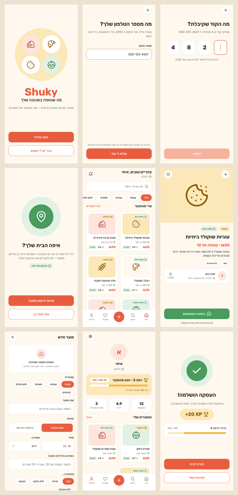

# Shuky · שוקי

**מה שנאפה בשכונה שלך** – a hyperlocal marketplace for home-baked goods. Neighbors who bake at home
(cakes, cookies, pastries, breads, desserts) sell to neighbors who want to buy, with seller ratings and
levels front and center. Items are either ready now or baked to order (pre-order). Launch community:
Lehavim. The app is mobile-first (iOS / Android), and the whole UI is Hebrew, right-to-left.

> **Status: Phase 1.** UI scaffold with static mock data. No backend yet.



## Running it

Requirements: Node 20+ and npm.

```bash
npm install
npm run web          # = npx expo start --web, opens http://localhost:8081
npm start            # Expo dev server for iOS / Android (Expo Go or a dev build)
```

| Script | What it does |
| --- | --- |
| `npm run web` | Dev server for the web build |
| `npm start` | Dev server (press `i` / `a` for simulators) |
| `npm run typecheck` | `tsc --noEmit` |
| `npm run lint` | `expo lint` (ESLint, `eslint-config-expo`) |
| `npm run build:web` | Static web export to `dist/` |

Environment variables: copy `.env.example` to `.env`. Phase 1 doesn't read any; the Supabase keys
are placeholders for Phase 2. Never commit real keys.

### RTL

- **Native:** `I18nManager.forceRTL(true)` at startup, plus `supportsRTL` / `forcesRTL` in `app.json`
  (via the `expo-localization` config plugin) so a dev build starts in RTL from the first launch.
  In Expo Go, the very first launch may need one reload before RTL applies.
- **Web:** react-native-web ignores `I18nManager`. `public/index.html` sets `<html dir="rtl" lang="he">`,
  and the app root (and modal roots) get `dir="rtl"` through `webDir()` in `src/lib/rtl.ts`.
- Layout uses logical sides only (`start` / `end`, `marginStart`, …), never `left` / `right`. The first
  child of a `row` is on the right.
- LTR snippets inside Hebrew text (phone numbers, `+20 XP`) are wrapped with `ltr()` (Unicode isolates).

## Project structure

```
src/
  app/                      Expo Router routes (every file is a screen)
    _layout.tsx             Root: fonts (Rubik), RTL, providers, stack
    index.tsx               Redirects to /welcome
    (onboarding)/           01 welcome · 02 phone · 03 otp · 04 location
    (tabs)/                 Bottom tabs: home (05) · search · saved · profile (08)
      _layout.tsx           Tabs navigator rendered with our BottomNav
    product/[id].tsx        06 product page
    listing/new.tsx         07 add listing (modal)
    trade/[id].tsx          09 trade completed
  components/               Design-system components (see below)
  theme/tokens.ts           Colors, radii, spacing, fonts, type scale
  data/                     Types, category config, mock data
  store/AppStore.tsx        In-memory store (listings, saved items) for Phase 1
  lib/                      format (distance/price/dates), whatsapp, levels/XP, rtl, navigation
public/index.html           Web shell (RTL, cream background)
docs/                       Screenshots
```

### Routes

| URL | Screen |
| --- | --- |
| `/welcome` | 01 · פתיחה |
| `/phone` | 02 · התחברות |
| `/otp` | 03 · קוד אימות |
| `/location` | 04 · מיקום |
| `/home` | 05 · בית (פיד) |
| `/product/:id` | 06 · עמוד מוצר |
| `/listing/new` | 07 · הוספת מוצר (opened by the + button) |
| `/profile` | 08 · פרופיל ורמה |
| `/trade/:id` | 09 · עסקה הושלמה |
| `/search`, `/saved` | Search and saved tabs (built from the same components) |

### Design system

Tokens live in `src/theme/tokens.ts` and mirror the Figma file: tomato (primary), leaf (freshness,
location, success), honey (baked goods, XP), cream background (never pure white), white cards,
1px `line` borders, radius 16–20, pill chips, no heavy shadows. Font: Rubik (400/500/600/700).

Components (`src/components`): `Button` (primary / secondary / leaf), `Chip`, `Input` (text or
select trigger), `ProductCard`, `BottomNav`, plus `AppText`, `IconButton`, `Pill`, `ProgressBar`,
`SegmentedControl`, `OtpInput`, `SellerCard`, `SearchField`, `CategoryChips`, `CategoryArt`,
`ProductGrid`, `SelectSheet`, `SectionHeader`, `EmptyState`, `StepHeader`, `Screen`, `WhatsAppIcon`.

Icons are [Lucide](https://lucide.dev) (`lucide-react-native`), the same line style as the Figma icons.

### Product model

- **Sales only.** Every listing has a price (no barter or giveaways).
- **Categories:** עוגות, עוגיות, מאפים, לחם וחלות, קינוחים (`src/data/categories.ts`).
- **Availability:** `ready` (baked on a given day) or `preorder` (baked to order, with a minimum notice:
  a day, two days, three days or a week).
- **Diet and kashrut tags:** כשר, פרווה, ללא גלוטן, טבעוני, ללא אגוזים.
- **Trust:** seller rating and level are shown on every card and on the product page.

### MVP rules and where they live

- **No in-app chat or payments.** Ordering goes through a WhatsApp deep link with a prefilled message
  (`src/lib/whatsapp.ts`, `wa.me`), and payment happens between the neighbors.
- **Distances are always rounded**, never an exact location: `formatDistance()` in `src/lib/format.ts`
  (nearest 50 m, or km with one decimal).
- **XP is awarded only when both sides confirm a trade.** `src/lib/levels.ts` holds the level ladder
  and `XP_PER_TRADE`. The trade-completed screen is a static preview in Phase 1, and the rule is
  enforced server-side in Phase 3.

## Roadmap

- **Phase 2:** Supabase schema (`profiles`, `listings` with availability / notice days / diet tags,
  `trades`, `ratings`) with RLS, phone OTP auth,
  photo upload to Storage, a PostGIS distance query that returns rounded distances only, and
  `expo-location` on the location screen.
- **Phase 3:** XP and level logic (both-sides confirmation), ratings, persisted saved items.
