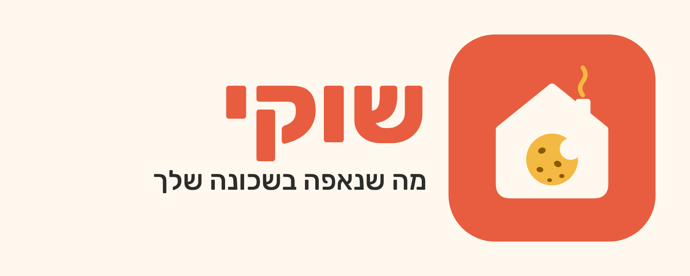

# Shuky · שוקי



**מה שנאפה בשכונה שלך** – a hyperlocal marketplace for home-baked goods. Neighbors who bake at home
(cakes, cookies, pastries, breads, desserts) sell to neighbors who want to buy, with seller ratings and
levels front and center. Items are either ready now or baked to order (pre-order). Launch community:
Lehavim. The app is mobile-first (iOS / Android), and the whole UI is Hebrew, right-to-left.

> **Status: Phase 3.** Supabase backend: sign-in with an email code, profiles, rounded location,
> listings with photos (edit / delete), trades confirmed by both sides with XP and levels, ratings,
> saved items and server notifications. Only free tools. Without a `.env` the app runs in **demo
> mode** on mock data.


## Running it

Requirements: Node 20+ and npm.

```bash
npm install
npm run web          # = npx expo start --web, opens http://localhost:8081
npm start            # Expo dev server for iOS / Android (Expo Go or a dev build)
```

| Script | What it does |
| --- | --- |
| `npm run web` | Dev server for the web build |
| `npm start` | Dev server (press `i` / `a` for simulators) |
| `npm run typecheck` | `tsc --noEmit` |
| `npm run lint` | `expo lint` (ESLint, `eslint-config-expo`) |
| `npm run build:web` | Static web export to `dist/` |

### Demo mode vs live mode

- **Demo** (no `.env`): everything runs in memory on `src/data/mock.ts`. Any email and any 4-digit
  code work. Good for design work and quick previews in Expo Go.
- **Live** (`.env` with your Supabase project): sign-in with a 6-digit code sent by email, profiles,
  rounded distances and listings with photos, all from Supabase.

Sign-in uses a free email code instead of SMS. Sellers still need a phone number for WhatsApp orders,
so new users enter one on the name screen (it isn't verified).

## Supabase setup (live mode)

1. Create a project at [supabase.com](https://supabase.com) (region: Frankfurt is closest to Israel).
2. **SQL Editor** → run each file in `supabase/migrations/` **in order** (paste → **Run**):
   `20261121120000_init.sql`, `20261122090000_email_auth.sql`, `20261122140000_phase3.sql`,
   `20261123090000_push.sql`, `20261124090000_security.sql`, then `20261125090000_compliance.sql`.
   This creates the tables, the security rules (RLS), the feed / trade / rating / notification
   functions and the `listing-photos` bucket.
3. **Email code** (free; the Email provider is on by default):
   **Authentication → Emails → Templates → Magic Link**: set the body to show the code, e.g.
   `<h2>הקוד שלך לשוקי</h2><p style="font-size:28px">{{ .Token }}</p>` and subject `הקוד שלך לשוקי`.
   Supabase's built-in mailer is limited to a few emails per hour, which is fine for testing. Before
   launch, connect a free SMTP service (e.g. Resend or Brevo free tiers) under
   **Authentication → Emails → SMTP Settings**.
4. **Project Settings → API**: copy the Project URL and the anon / publishable key into a `.env` file
   (see `.env.example`). Never use the `service_role` / secret key in the app.
5. Restart with a clean cache: `npx expo start --clear`.

### Push notifications (free)

Every in-app notification the server creates is also sent as a push through the free Expo Push
Service, straight from the database (`pg_net`, enabled by the push migration). No extra server.

1. Link the app to a free Expo project once: `npx eas-cli@latest init` (adds `extra.eas.projectId`
   to `app.json`; commit it). Without it the app skips push registration.
2. **iPhone:** pushes work in Expo Go once the project id is set.
   **Android:** Expo Go no longer receives pushes (since SDK 53). Make a development build with EAS
   (free tier): `npx eas-cli@latest build --profile development --platform android`, and add Firebase
   Cloud Messaging credentials (a free Firebase project) with `npx eas-cli@latest credentials`.
3. The app asks for permission when you enter the app; Settings shows a shortcut if it's blocked.
   Notification preferences apply to pushes too. Signing out removes this device.

In demo mode the phone shows a local notification when a demo trade completes.

## Security

Enforced in the database (RLS, column grants, `SECURITY DEFINER` functions), not just in the app.
`supabase/tests` holds 78 checks; run them with `supabase/tests/run.sh`.

- **Privacy:** locations are rounded on the phone, snapped to ~100 m and never readable by others;
  the feed shows a rounded distance only. Phone numbers can't be read in bulk: the WhatsApp number
  of one seller is returned only when tapping "order" (`get_seller_whatsapp()`, logged, max 20 new
  sellers a day). Photos are re-encoded and stripped of EXIF / GPS before upload.
- **Integrity:** XP, rating and phone are server-managed. XP needs both sides to confirm, once per
  pair of neighbors per 7 days, max 3 XP trades a day. One rating per neighbor per 30 days.
- **Abuse:** rate limits on listings (10/day), trades (15/day), reports (20/day). Location must be
  inside the community area to post. Report & block (blocks hide listings, notifications, contact
  and trades both ways). A listing reported by 3 established neighbors is hidden until reviewed:
  check **Table Editor → reports** in Supabase regularly (Apple expects reports to be handled).
- **Optional CAPTCHA (free):** create a Cloudflare Turnstile widget (add the hostname from
  `EXPO_PUBLIC_TURNSTILE_BASE_URL`), put its secret in Supabase → Authentication → Attack
  Protection, and its site key in `.env` as `EXPO_PUBLIC_TURNSTILE_SITE_KEY`.
- After running the migrations, open Supabase → **Advisors → Security** and fix anything it flags.

## Privacy & compliance checklist

| Risk | How Shuky handles it |
| --- | --- |
| No privacy policy | In-app + public pages (`docs/privacy.html`), linked at sign-up |
| Undisclosed data collection | Policy lists every field; ready answers for the store forms in `docs/store-privacy-answers.md`; Settings → הורדת המידע שלי exports everything (`export_my_data()`) |
| Uploads not deleted | Deleting a listing, replacing a photo or deleting the account removes the files (account deletion aborts if the photos can't be removed). Old notifications / logs are purged nightly (`purge_old_data()` via pg_cron) |
| Public storage buckets | `listing-photos` is private; only signed-in neighbors who can see the listing get short-lived signed URLs |
| Fake testimonials | Mock data exists only in demo mode, labelled on the home screen; a production build without Supabase refuses to run the demo. Don't use demo screenshots in the store |
| Hard to cancel / trial reminders | No subscriptions, trials or in-app payments (stated in the terms); account deletion is two taps |
| Self-harm response | Settings → בטיחות ועזרה: ער״ן 1201, מד״א 101, משטרה 100 and safety tips; "פגיעה עצמית או סכנה לאדם" report reason opens it |

This is not legal advice: Israeli privacy law (incl. Amendment 13) applies; have the texts reviewed.

## Privacy policy & terms

One source, `src/content/legal.ts`, feeds both:
- the in-app screens `/legal/privacy` and `/legal/terms` (linked from the sign-up screen and Settings);
- public pages for the store listings: `npm run legal:export` writes `docs/privacy.html`,
  `docs/terms.html` and `docs/index.html`.

Host them for free with GitHub Pages: repo **Settings → Pages → Deploy from a branch → `main` /
`docs`**. The URLs become `https://itaydalumi.github.io/Shuky/privacy.html` and `.../terms.html`.
Before launch: set `OPERATOR_NAME` and `CONTACT_EMAIL` in `src/content/legal.ts`, re-run the export,
and have the text reviewed by a lawyer.

The database tests in `supabase/tests` check the security rules against a local Postgres + PostGIS
(see `supabase/tests/run.sh`).

### RTL

- **Native:** `I18nManager.forceRTL(true)` at startup, plus `supportsRTL` / `forcesRTL` in `app.json`
  (via the `expo-localization` config plugin) so a dev build starts in RTL from the first launch.
  In Expo Go, the very first launch may need one reload before RTL applies.
- **Web:** react-native-web ignores `I18nManager`. `public/index.html` sets `<html dir="rtl" lang="he">`,
  and the app root (and modal roots) get `dir="rtl"` through `webDir()` in `src/lib/rtl.ts`.
- Layout uses logical sides only (`start` / `end`, `marginStart`, …), never `left` / `right`. The first
  child of a `row` is on the right.
- LTR snippets inside Hebrew text (phone numbers, `+20 XP`) are wrapped with `ltr()` (Unicode isolates).

## Project structure

```
src/
  app/                      Expo Router routes (every file is a screen)
    _layout.tsx             Root: fonts (Rubik), RTL, providers, stack
    index.tsx               Start: resumes the session, or goes to /welcome
    (onboarding)/           01 welcome · 02 email · 03 otp · name (new users) · 04 location
    (app)/                  Signed-in area (its _layout redirects to /welcome when signed out)
      (tabs)/               Bottom tabs: home (05) · search · saved · profile (08)
      product/[id].tsx      06 product page
      listing/new.tsx       07 add listing (modal)
      trade/[id].tsx        09 trade: confirm, waiting, completed + rating
      trades.tsx            My trades
      notifications.tsx     Notifications list
      settings.tsx          Settings
  components/               Design-system components (see below)
  theme/tokens.ts           Colors, radii, spacing, fonts, type scale
  data/                     Types, category config, mock data
  store/AppStore.tsx        App state: live (Supabase) or demo (mock) mode
  lib/supabase.ts           Supabase client (session kept in AsyncStorage)
  lib/api.ts                Live-mode calls: auth, profile, location, feed, listings, delete account
  lib/                      Also: format, whatsapp, levels/XP, rtl, navigation, confirm
supabase/
  migrations/               Database schema, RLS, functions, storage bucket
  tests/                    Security tests for the schema (local Postgres + PostGIS)
public/index.html           Web shell (RTL, cream background)
docs/                       Screenshots
```

### Routes

| URL | Screen |
| --- | --- |
| `/welcome` | 01 · פתיחה |
| `/email` | 02 · התחברות (email) |
| `/otp` | 03 · קוד אימות |
| `/name` | Name + WhatsApp number for new users (after the code) |
| `/location` | 04 · מיקום |
| `/home` | 05 · בית (פיד) |
| `/product/:id` | 06 · עמוד מוצר |
| `/listing/new` | 07 · הוספת מוצר (opened by the + button) |
| `/profile` | 08 · פרופיל ורמה |
| `/trade/:id` | 09 · Trade: confirm / waiting / completed (+XP, rating) |
| `/search`, `/saved` | Search and saved tabs (built from the same components) |
| `/trades` | העסקאות שלי: waiting for me, waiting for the other side, completed |
| `/notifications` | Notifications (bell on the home screen) |
| `/settings` | Settings: profile, notification toggles, privacy, sign out, delete account |

### Design system

Logo: a layered cake slice with a cherry on top, cream and honey on tomato. Source:
`docs/brand/logo.svg`; app icons in `assets/` (iOS icon, Android adaptive foreground / background /
monochrome, splash, favicon). An alternative (a house made of cake) is in `docs/brand/`.

Tokens live in `src/theme/tokens.ts` and mirror the Figma file: tomato (primary), leaf (freshness,
location, success), honey (baked goods, XP), cream background (never pure white), white cards,
1px `line` borders, radius 16–20, pill chips, no heavy shadows. Font: Rubik (400/500/600/700).

Components (`src/components`): `Button` (primary / secondary / leaf), `Chip`, `Input` (text or
select trigger), `ProductCard`, `BottomNav`, plus `AppText`, `IconButton`, `Pill`, `ProgressBar`,
`SegmentedControl`, `OtpInput`, `SellerCard`, `SearchField`, `CategoryChips`, `CategoryArt`,
`ProductGrid`, `SelectSheet`, `SectionHeader`, `EmptyState`, `StepHeader`, `Screen`, `WhatsAppIcon`.

Icons are [Lucide](https://lucide.dev) (`lucide-react-native`), the same line style as the Figma icons.

### Product model

- **Sales only.** Every listing has a price (no barter or giveaways).
- **Categories:** עוגות, עוגיות, מאפים, לחם וחלות, קינוחים (`src/data/categories.ts`).
- **Availability:** `ready` (baked on a given day) or `preorder` (baked to order, with a minimum notice:
  a day, two days, three days or a week).
- **Diet and kashrut tags:** כשר, פרווה, ללא גלוטן, טבעוני, ללא אגוזים.
- **Trust:** seller rating and level are shown on every card and on the product page.

### MVP rules and where they live

- **No in-app chat or payments.** Ordering goes through a WhatsApp deep link with a prefilled message
  (`src/lib/whatsapp.ts`, `wa.me`), and payment happens between the neighbors.
- **Distances are always rounded**, never an exact location. The phone rounds the position, the
  database snaps it to a ~100 m grid, no user can read another user's point, and the feed
  (`nearby_listings()`) returns only a distance rounded to 50 m. The app shows "350 מ׳ ממך".
- **XP is awarded only when both sides confirm a trade.** The buyer taps "קניתי את זה" on the
  product page, the seller confirms (from the notification or "העסקאות שלי"), and only then does
  `confirm_trade()` give each side +20 XP, once. Either side can cancel a pending trade. After a
  completed trade each side can rate the other once (1–5 stars); the seller's average updates.

## Roadmap

- **Phase 2 (done):** Supabase schema with RLS, email-code sign-in, name + WhatsApp step, location
  via `expo-location`, PostGIS feed with rounded distances, photo upload to Storage, delete account.
- **Phase 3 (done):** trade confirmation by both sides with XP and level-ups, ratings, saved items
  and notifications on the server (created by triggers, respecting preferences), edit / delete
  your own listings.
- **Push notifications (done):** Expo Push Service from the database, device registration, tap to open.
- **Privacy policy & terms (done):** in-app screens + public pages for the stores.
- **Next:** store builds (EAS), store listings.
